# ¡Hola! Soy Lucas Nicolas 👋

**Junior Full Stack Developer | Frontend & Backend**

Soy un entusiasta de la tecnología y el desarrollo de software, enfocado en construir mi camino profesional como desarrollador Full Stack.

Tengo conocimientos de desarrollo frontend y fundamentos de programación, además de experiencia práctica adquirida mediante proyectos personales.

Me interesa comprender cómo funcionan las aplicaciones de principio a fin: desde la interfaz que utiliza el usuario hasta la lógica y los sistemas que funcionan detrás de ella.

---

## 🛠️ Tecnologías y herramientas

**Desarrollo web**

**Otros lenguajes**

*Java y Python: conocimientos básicos.*

**Control de versiones**

**Herramientas y entorno**

---

## 🚀 Proyectos

[**Ver demo**](https://ragnarokproyect.netlify.app/) · [**Código fuente**](https://github.com/Niclucca/ragnarok-barber)

[**Ver demo**](https://niclucca.github.io/micks-pizzeria/) · [**Código fuente**](https://github.com/Niclucca/micks-pizzeria)

---

## 📚 Actualmente enfocado en

- Fortalecer mis conocimientos de desarrollo frontend.
- Profundizar en programación y desarrollo backend.
- Aprender sobre bases de datos y APIs.
- Mejorar mis prácticas de programación y calidad de código.
- Construir proyectos personales cada vez más completos.

---

## 🎯 Objetivo profesional

Crecer como Full Stack Developer, adquirir experiencia laboral y participar en proyectos donde pueda aportar mis conocimientos, compromiso y capacidad de aprendizaje.

---

*Construyendo, aprendiendo y mejorando un proyecto a la vez.*
